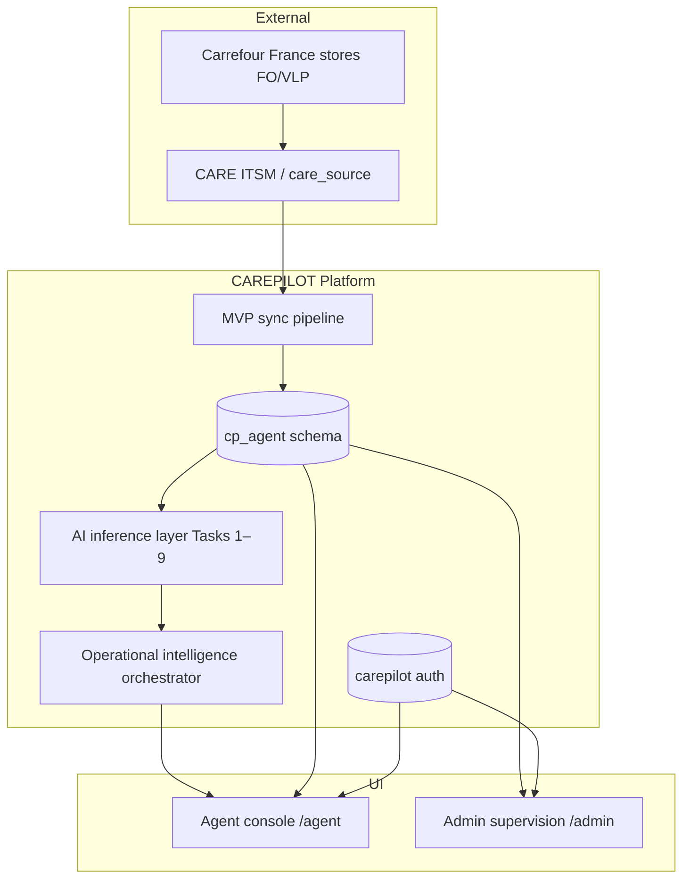
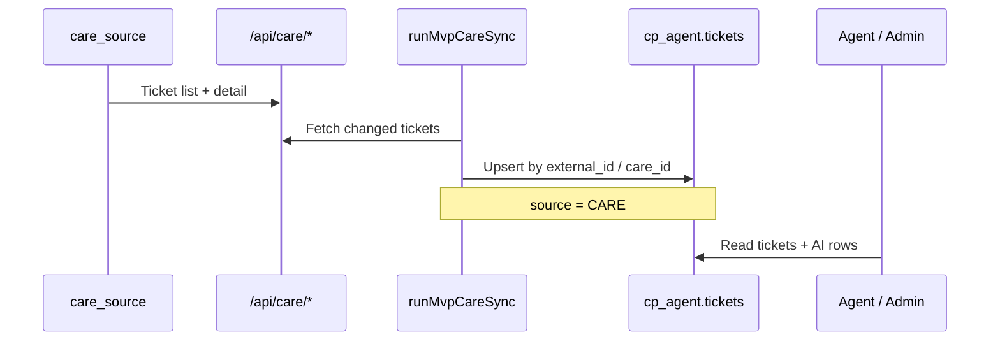

# CAREPILOT — Global Architecture

## Purpose

CAREPILOT is an enterprise operational intelligence layer on top of Carrefour CARE ITSM. It synchronizes store incidents into an agent workspace, runs ML/NLP/LLM analysis, and presents a unified investigation workflow for N1/N2 support.

## System context



## Data layers

| Schema | Role | Key entities |
|--------|------|--------------|
| `care_source` | CARE system of record | `stores`, `tickets`, `km_procedures`, `ticket_comments`, `ticket_actions` |
| `cp_agent` | Operational mirror + AI outputs | `tickets`, `ticket_history`, `ticket_comments`, `ai_*` prediction tables |
| `carepilot` | Authentication | `users`, `sessions` |
| `ml_training` | Offline benchmark datasets | `historical_tickets`, KM corpus — **not** runtime |

## Synchronization flow



- Scheduler: `instrumentation.ts` (unless `DISABLE_SYNC_SCHEDULER=1`)
- Internal APIs: `/api/sync/run`, `/api/sync/status`, `/api/sync/logs`
- Demo tickets: `CARE-DEMO-*` seeded via `bun run db:seed:demo-scenarios` (append to care_source + cp_agent)

## Application surfaces

| Surface | Path | Purpose |
|---------|------|---------|
| Agent dashboard | `/agent/dashboard` | Queue overview — open, SLA at risk, core KPIs |
| Ticket investigation | `/agent/tickets/{id}` | Primary workflow — incident + operational intelligence panel |
| Admin supervision | `/admin/*` | Escalations, recommendations, AI run controls |
| Orchestration API | `GET /api/ai/orchestration/{ticketId}` | Unified intelligence JSON payload |

## Ticket investigation layout

The ticket page is designed as an **operational investigation interface**, not an analytics dashboard:

- **Left column:** command bar, title, description, comments, timeline
- **Right column:** unified operational intelligence (quality → risk → action → KM → explanation)

## Deployment stack

| Layer | Technology |
|-------|------------|
| Frontend | Next.js App Router, React, shadcn/ui |
| Backend | Next.js API routes, Drizzle ORM |
| Database | PostgreSQL |
| ML inference | Python artifacts (joblib) + TypeScript runners |
| LLM | Ollama local (`mistral`) |
| Training | `ml/` benchmarks, Jupyter notebooks, `ml_training` schema |

## Reset & demo bootstrap

```bash
bun run db:seed:care-operational   # 36 stores, 70 CARE-OP tickets
bun run db:seed:cp-agent           # support agents
bun run db:sync                    # sync 70 tickets to cp_agent
bun run db:seed:demo-scenarios     # 8 PFE demo tickets + deterministic AI
```

See [demo-manifest.json](../demo-scenarios/demo-manifest.json) for current ticket IDs.
