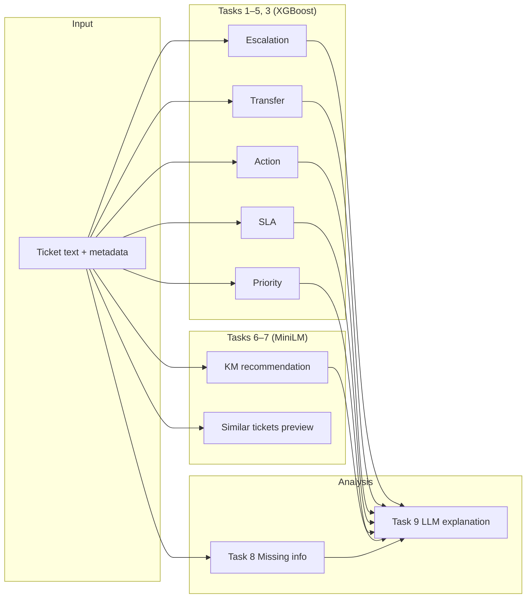

# CAREPILOT — AI Architecture

## Overview

Nine complementary AI capabilities support ITSM decision-making. Tasks 1–5 and 3 use **XGBoost** classifiers; Tasks 6–7 use **sentence-transformer retrieval**; Task 8 uses **rule-based heuristics**; Task 9 uses a **local LLM** (Ollama/Mistral) for narrative explanation.



## Task catalog

| Task | Capability | Production model | Storage table |
|------|------------|------------------|---------------|
| 1 | Escalation prediction | XGBoost `xgboost_escalation_v1` | `cp_agent.ai_escalation_predictions` |
| 2 | Transfer prediction | XGBoost `xgboost_transfer_v1` | `cp_agent.ai_transfer_predictions` |
| 3 | Action recommendation | XGBoost `xgboost_action_v1` | `cp_agent.ai_action_recommendations` |
| 4 | SLA breach prediction | XGBoost `xgboost_sla_v1` | `cp_agent.ai_sla_predictions` |
| 5 | Priority prediction | XGBoost `xgboost_priority_v1` | `cp_agent.ai_priority_predictions` |
| 6 | KM recommendation | MiniLM retrieval `minilm_km_v1` | `cp_agent.ai_km_recommendations` |
| 7 | Similar ticket retrieval | Preview seed (benchmark paused in UI) | `cp_agent.ai_similar_ticket_results` |
| 8 | Missing information | Heuristics `heuristics_missing_info_v1` | `cp_agent.ai_missing_information_analysis` |
| 9 | Operational explanation | Ollama Mistral `ollama_mistral_v1` | `cp_agent.ai_operational_explanations` |

## Runtime pipeline

```mermaid
flowchart TB
  Ticket[cp_agent.tickets]
  Run[ai:*:run scripts or admin buttons]
  Artifacts[ml/artifacts/models/*.joblib]
  DB[(cp_agent.ai_* tables)]
  API[/api/ai/{module}/*]
  Orch[Orchestrator]

  Ticket --> Run
  Artifacts --> Run
  Run --> DB
  DB --> API
  DB --> Orch
```

### Batch runners (`package.json`)

```
ai:escalation:run  ai:transfer:run  ai:action:run  ai:sla:run
ai:priority:run    ai:km:run        ai:missing-information:run
ai:llm-explanations:run
```

Task 9 reads Tasks 1–8 outputs from DB before generating explanations. Requires Ollama at `OLLAMA_BASE_URL`.

## Training vs production

| Concern | Training (`ml/`) | Production (`lib/ai/`) |
|---------|------------------|------------------------|
| Data | `ml_training.historical_tickets` | `cp_agent.tickets` |
| Execution | Python benchmarks, notebooks | TypeScript `run-*.ts` |
| Artifacts | `ml/artifacts/models/` | Loaded at inference |
| Metrics | `ml/plots/`, `ml/reports/` | Not written to UI during train |

## Benchmark highlights (held-out test)

Primary report visuals: `ml/plots/03_*_benchmark_results_table.png`

| Task | Best model | Key metric | Report PNG |
|------|------------|------------|------------|
| 1 Escalation | XGBoost | F1 ≈ 0.85 | `03_escalation_benchmark_results_table.png` |
| 2 Transfer | XGBoost | F1 ≈ 0.90 | `03_transfer_benchmark_results_table.png` |
| 3 Action | XGBoost | Macro-F1 | `03_action_recommendation_benchmark_results_table.png` |
| 4 SLA | XGBoost | F1 / AUC | `03_sla_benchmark_results_table.png` |
| 5 Priority | XGBoost | Macro-F1 | `03_priority_benchmark_results_table.png` |
| 6 KM | MiniLM + BM25 | MRR / P@k | `03_km_benchmark_results_table.png` |
| 7 Similar | MiniLM (benchmark) | MRR / P@k | `03_similar_ticket_benchmark_results_table.png` |
| 8 Missing info | Heuristics | Micro-F1 ≈ 0.61 | `03_missing_information_benchmark_results_table.png` |
| 9 LLM | Mistral (Ollama) | Rubric score ≈ 4.07/5 | `03_llm_explanation_benchmark_results_table.png` |

Full narrative: `ml/reports/03_*_summary.md`

## Feature flags

Centralized in `lib/ai-phase.ts` — all nine tasks **enabled** for PFE scope. Similar ticket **live retrieval** disabled; preview seed used instead.

## Design principles

1. **Deterministic predictions first** — LLM explains, does not replace ML labels
2. **No training writes to operational UI** — benchmarks isolated in `ml/`
3. **Per-ticket idempotent upserts** — one row per ticket per module (KM: ranked list)
4. **Enterprise semantics** — shared labels via `lib/ai/operational-ui.ts`
