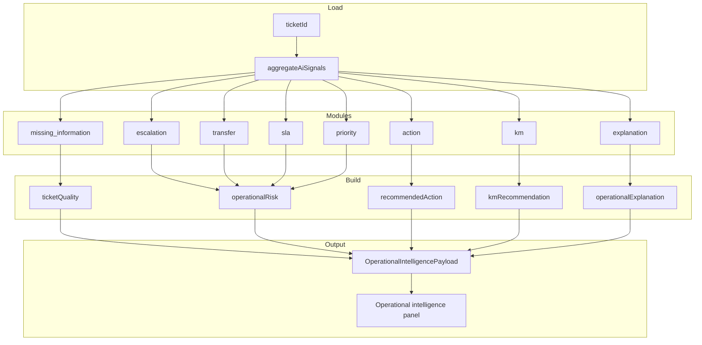
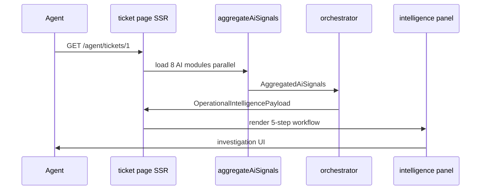

# CAREPILOT — Orchestration Flow

## Purpose

The orchestration layer transforms nine independent AI module outputs into **one operational intelligence payload** consumed by the ticket investigation UI and demo/report screenshots.

## Code map

| File | Responsibility |
|------|----------------|
| `lib/ai/orchestration/ai-signal-aggregator.ts` | Parallel load of all AI rows for a ticket |
| `lib/ai/orchestration/operational-risk-summary.ts` | Escalation, transfer, SLA, priority → severity signals |
| `lib/ai/orchestration/operational-intelligence-orchestrator.ts` | Build unified payload + meta |
| `lib/ai/orchestration/types.ts` | `OperationalIntelligencePayload` TypeScript types |
| `app/api/ai/orchestration/[ticketId]/route.ts` | `GET` → `{ ok, intelligence }` |

## End-to-end flow



## Unified payload structure

```json
{
  "meta": {
    "ticketId": 1,
    "careId": "CARE-DEMO-00001",
    "generatedAt": "ISO-8601",
    "modulesAvailable": 5,
    "modulesTotal": 5,
    "primarySignal": "action"
  },
  "ticketQuality": { "completenessPct", "qualityLevel", "warnings", ... },
  "operationalRisk": { "overallLevel", "headline", "signals[]" },
  "recommendedAction": { "actionLabel", "reason", "confidencePct" },
  "kmRecommendation": { "primary", "alternatives[]" },
  "operationalExplanation": { "operationalSummary", "reasoning", "nextSteps" }
}
```

## UI section mapping

Investigation workflow order on `/agent/tickets/{id}`:

| Step | Payload section | Visual priority |
|------|-----------------|-----------------|
| 01 | `ticketQuality` | High when incomplete |
| 02 | `operationalRisk` | Collapsible; open when elevated |
| 03 | `recommendedAction` | **Primary** — sticky decision bar |
| 04 | `kmRecommendation` | Collapsible when match exists |
| 05 | `operationalExplanation` | Second emphasis — narrative |

## Signal prioritization logic

`meta.primarySignal` resolution order:

1. `action` — if action recommendation available
2. `explanation` — else if LLM explanation available
3. `risk` — else if risk signals available
4. `quality` — else if completeness analysis available
5. `km` — else if KM match available

Severity labels (shared admin/agent): **High · Elevated · Low · Neutral** via `lib/ai/operational-ui.ts`.

## API usage

```http
GET /api/ai/orchestration/1
```

Response:

```json
{ "ok": true, "intelligence": { ... } }
```

Server-side rendering on the ticket page calls `aggregateAiSignals` + `orchestrateOperationalIntelligence` directly (no extra HTTP hop).

## Demo scenarios

Eight deterministic scenarios seed all `ai_*` tables so orchestration output is stable for jury demos:

| Slug | CARE ID | Primary signal |
|------|---------|----------------|
| escalation | CARE-DEMO-00001 | action → Escalate N3 |
| transfer | CARE-DEMO-00002 | action → Transfer |
| incomplete-ticket | CARE-DEMO-00004 | quality + Request information |
| sla-critical | CARE-DEMO-00005 | risk + Escalate N3 |
| local-resolution | CARE-DEMO-00003 | km + Resolve locally |
| false-escalation-risk | CARE-DEMO-00006 | action vs moderate escalation |
| network-payment-ambiguity | CARE-DEMO-00007 | transfer + dual KM |
| monitoring | CARE-DEMO-00008 | action → Monitor |

Seed: `bun run db:seed:demo-scenarios` → [demo-manifest.json](../demo-scenarios/demo-manifest.json)

## Sequence (agent opens ticket)


