# CarePilot SLA Breach Prediction Benchmark

## 1. Objective
Predict whether a ticket is likely to violate SLA before resolution (`sla_breached`). This benchmark evaluates proactive operational intelligence for support prioritization, supervision, and escalation.

## 2. Problem Definition
- **Target:** `sla_breached` (binary)
- **Problem type:** Binary classification
- **Outputs:** SLA breach risk, probability score, confidence score
- **Models:** Logistic Regression, Random Forest, XGBoost

## 3. Dataset Characteristics
The benchmark uses `ml_training.historical_tickets`. The dataset remains noisy, ambiguous, and realistic — SLA breach is not perfectly correlated with priority, escalation, transfer, or resolution time.

### Dataset Statistics
- Total tickets: 14000
- Historical actions: 32766
- Historical resolutions: 8233
- KM articles: 92
- Train / validation / test: 9800 / 2100 / 2100
- Positive class rate (`sla_breached=1`): 31.82%
- Missing description rate: 7.96%
- Missing resolution time rate: 41.19%

### Class Distribution
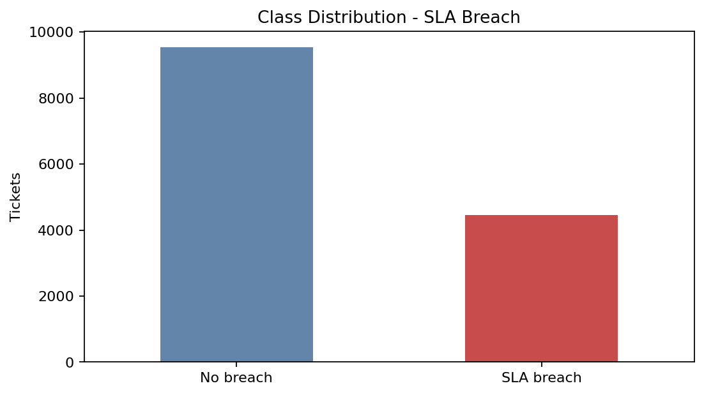

### Exploratory Analysis
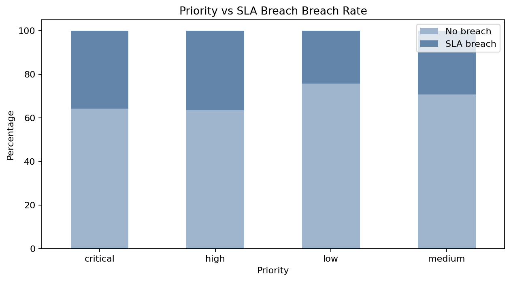

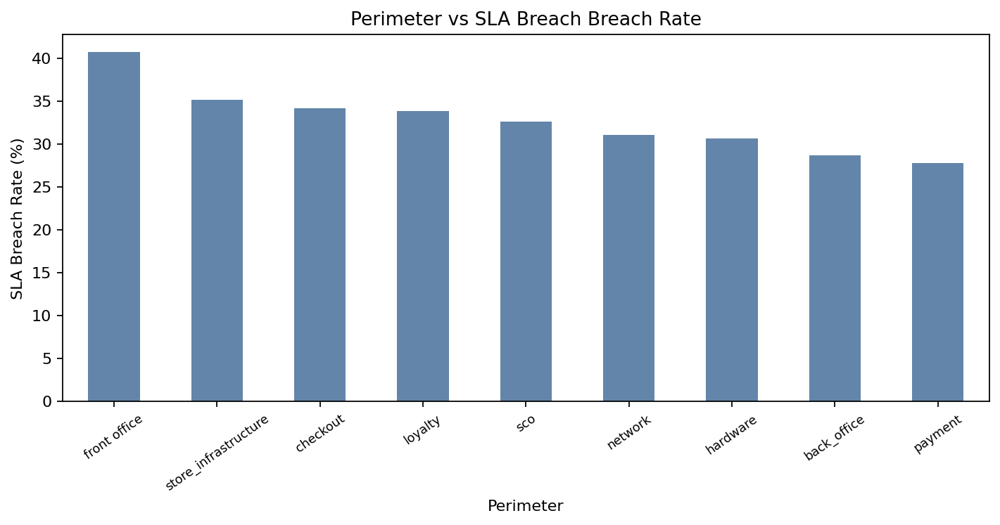

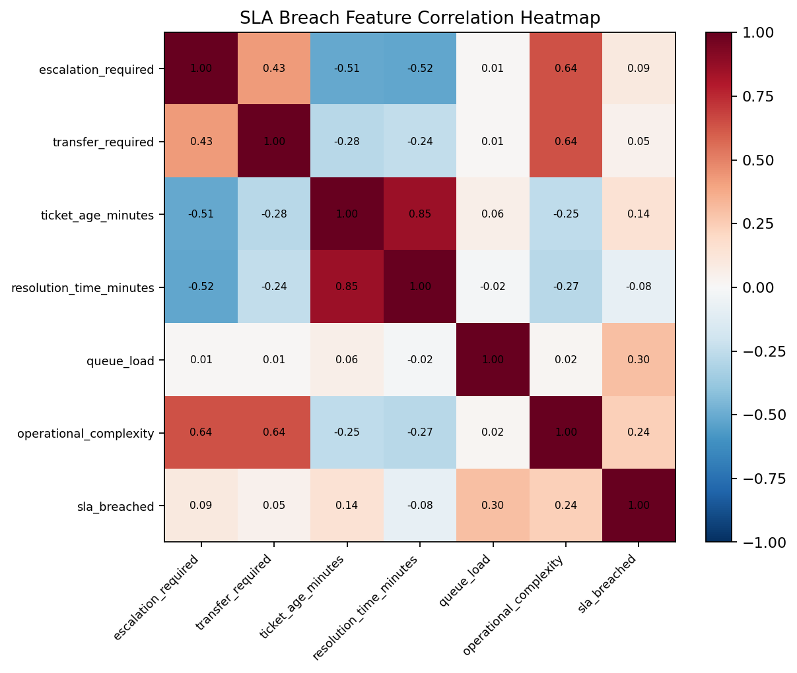

## 4. Preprocessing
- Text normalization on title and description
- Missing value handling with explicit missingness indicators
- TF-IDF vectorization (unigrams + bigrams)
- Categorical one-hot encoding
- Numeric median imputation and scaling
- Stratified split: train 70% / validation 15% / test 15%

## 5. Features
- `title`, `description`, `perimeter`, `priority`
- `escalation_required`, `transfer_required`, `recommended_action`
- `ticket_age_minutes`, `resolution_time_minutes`, `queue_load`, `store_size`
- `incident_category`, `environment_type`, `operational_complexity`
- Missingness indicators for description and resolution time

## 6. Benchmark Methodology
Each model is trained on the training split and evaluated on the held-out test split. Metrics include Accuracy, Precision, Recall, F1-score, ROC-AUC, training time, and inference time. F1 and Recall are emphasized because missing risky tickets is operationally critical.

### 5-Fold Cross Validation
| Model | Mean Accuracy | Std Deviation |
| --- | --- | --- |
| Logistic Regression | 0.766 | 0.005 |
| Random Forest | 0.774 | 0.009 |
| XGBoost | 0.862 | 0.001 |

## 7. Metrics and Comparison
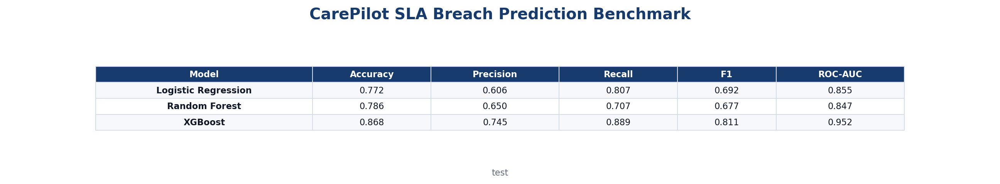

| Model | Accuracy | Precision | Recall | F1 | ROC-AUC |
| --- | --- | --- | --- | --- | --- |
| Logistic Regression | 0.772 | 0.606 | 0.807 | 0.692 | 0.855 |
| Random Forest | 0.786 | 0.650 | 0.707 | 0.677 | 0.847 |
| XGBoost | 0.868 | 0.745 | 0.889 | 0.811 | 0.952 |

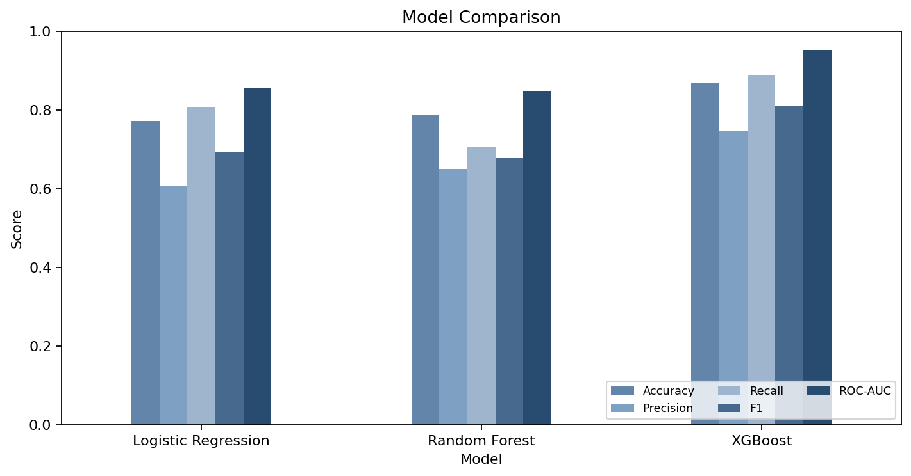

### Runtime Metrics
| Model | Training Time (s) | Inference Time (ms/row) |
| --- | --- | --- |
| Logistic Regression | 0.3461 | 0.0577 |
| Random Forest | 1.8684 | 0.1146 |
| XGBoost | 3.5241 | 0.0927 |

## 8. Confusion Matrices
Best model by F1-score: **XGBoost**.

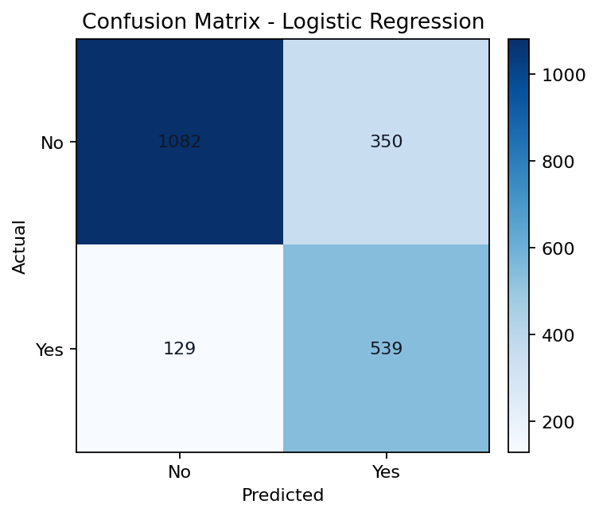

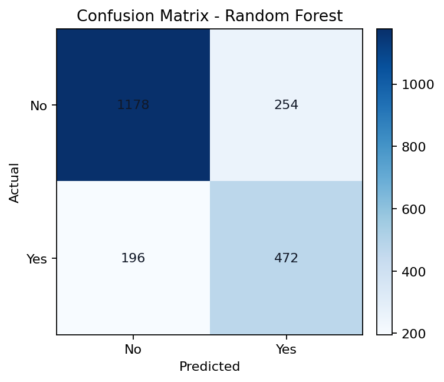

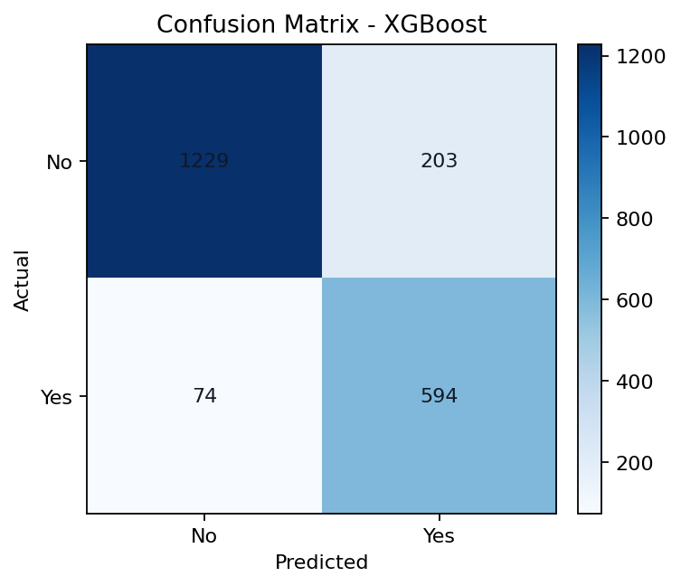

### Normalized Confusion Matrices
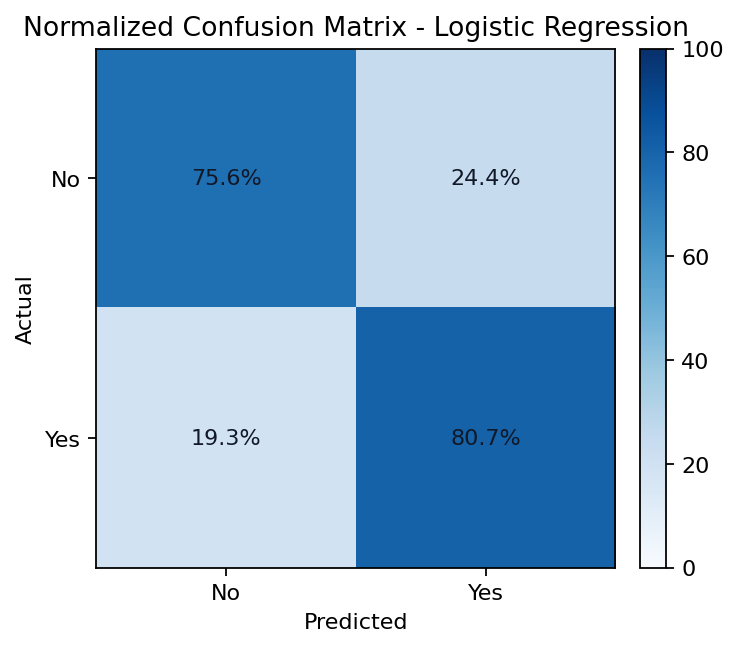

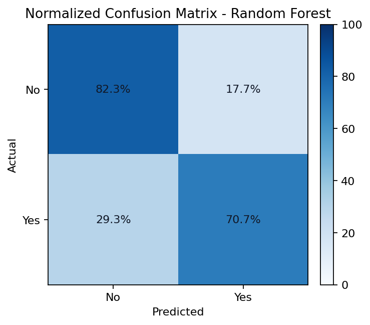

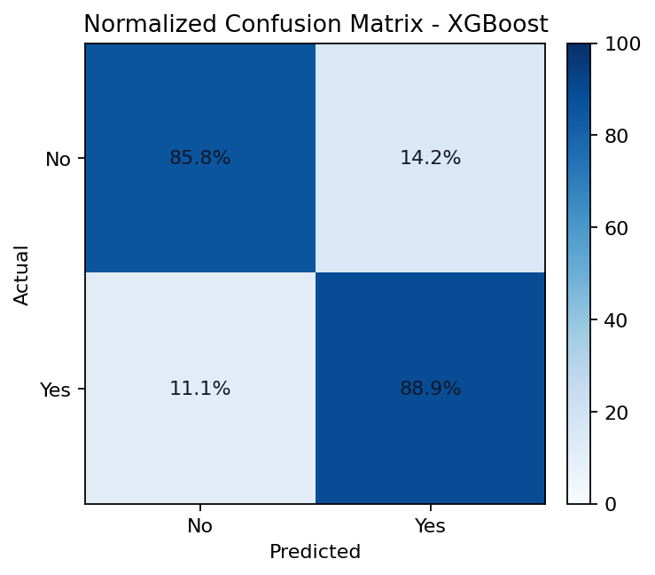

## 9. Classification Report
### Logistic Regression
| Class | Precision | Recall | F1-score | Support |
| --- | --- | --- | --- | --- |
| No breach | 0.893 | 0.756 | 0.819 | 1432 |
| SLA breach | 0.606 | 0.807 | 0.692 | 668 |

### Random Forest
| Class | Precision | Recall | F1-score | Support |
| --- | --- | --- | --- | --- |
| No breach | 0.857 | 0.823 | 0.840 | 1432 |
| SLA breach | 0.650 | 0.707 | 0.677 | 668 |

### XGBoost
| Class | Precision | Recall | F1-score | Support |
| --- | --- | --- | --- | --- |
| No breach | 0.943 | 0.858 | 0.899 | 1432 |
| SLA breach | 0.745 | 0.889 | 0.811 | 668 |

## 10. ROC and Precision/Recall
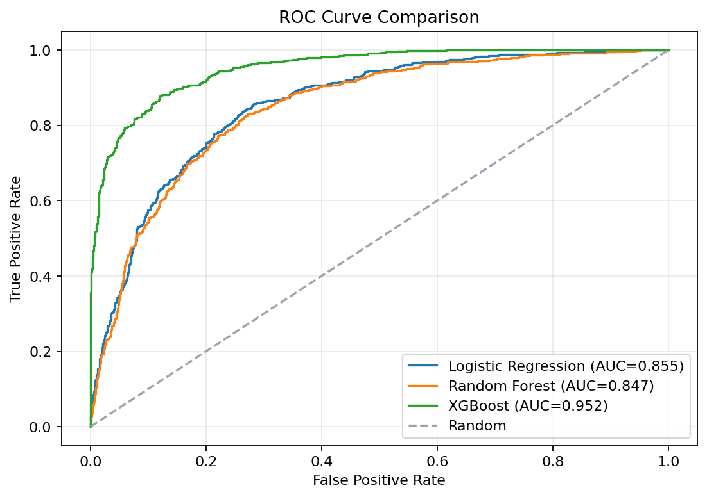

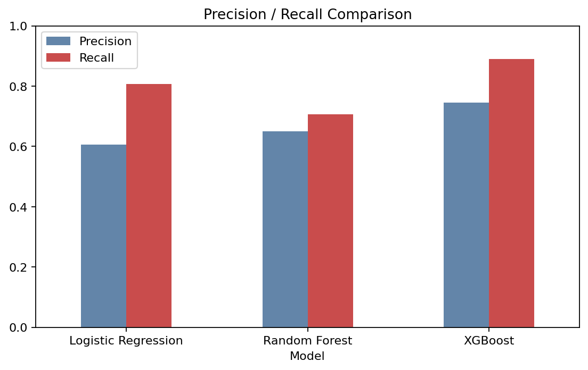

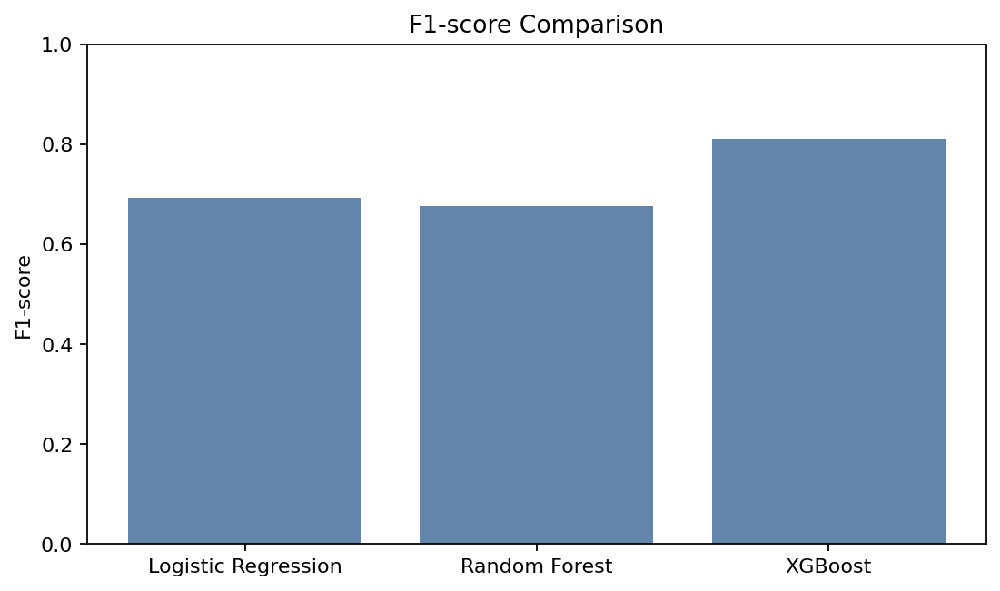

## 11. Feature Importance
### Random Forest
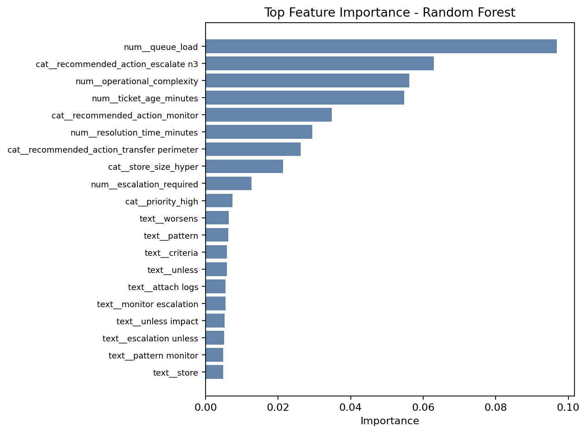

### XGBoost
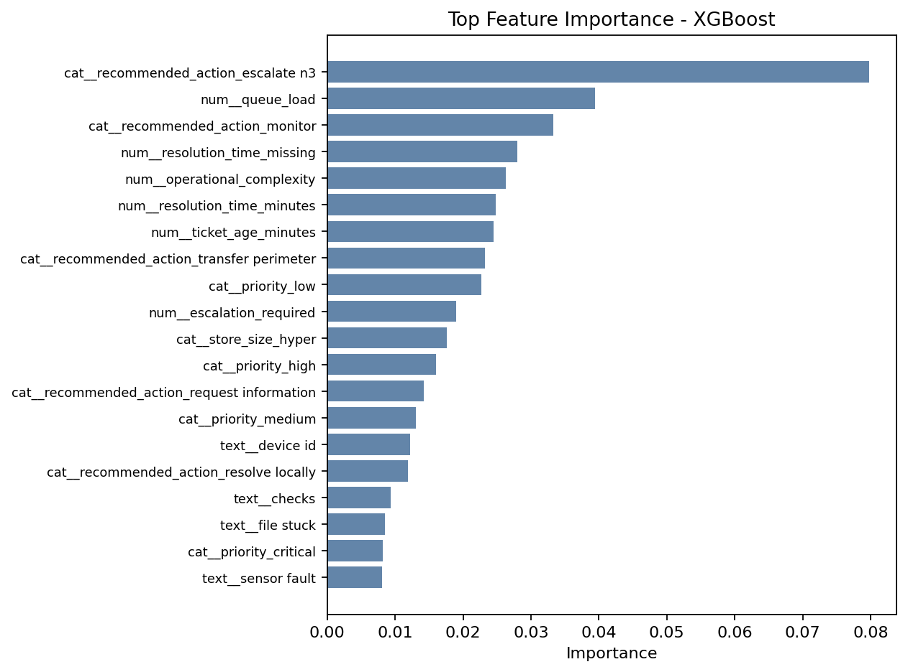

## 12. Interpretation
- Logistic Regression provides a transparent baseline with moderate recall — useful for explainability but weaker ranking of SLA risk.
- Random Forest captures nonlinear queue and perimeter effects with balanced precision/recall trade-offs.
- XGBoost delivers the strongest F1 and recall balance for operational triage while staying within realistic enterprise performance bands.

## 13. Best Model Selection
**XGBoost** is selected for CAREPILOT production inference (`xgboost_sla.joblib`) because it maximizes F1 on the held-out test split while maintaining acceptable inference latency.

## 14. Operational Implications
- High-recall SLA predictions support proactive prioritization before breach.
- Risk levels (`HIGH`, `MEDIUM`, `LOW`) enable supervisor dashboards and queue balancing.
- Combined with Tasks 1–3 (escalation, transfer, action), CAREPILOT forms a full operational AI layer.

## 15. Limitations
- Historical resolution-time signals may not always be available at ticket creation in live workflows.
- Store queue dynamics and missing information create irreducible ambiguity.
- Model performance should be monitored as operational patterns evolve.

## Saved Visuals
- Class distribution: `03_sla_distribution.png`
- Priority vs SLA breach: `03_priority_vs_sla.png`
- Perimeter vs SLA breach: `03_perimeter_vs_sla.png`
- Correlation heatmap: `03_sla_correlation_heatmap.png`
- ROC curves: `03_sla_roc_curves.png`
- Precision/Recall: `03_sla_precision_recall.png`
- F1 comparison: `03_sla_f1_score.png`
- Results table: `03_sla_benchmark_results_table.png`
