# CarePilot Transfer Prediction Benchmark

## 1. Objective
This benchmark evaluates the prediction of `transfer_required` for Carrefour France operational ITSM tickets. The goal is to compare three academically clean and enterprise-relevant models before any operational AI activation.

## 2. Dataset Description
The benchmark uses the isolated `ml_training.historical_tickets` dataset. It is intentionally realistic: noisy text, incomplete descriptions, inconsistent perimeter formatting, ambiguous root causes, and controlled class imbalance. The dataset is not connected to `care_source`, `cp_agent`, or dashboard AI metrics.

## 3. Dataset Statistics
- Total tickets: 14000
- Historical actions: 34779
- Historical resolutions: 10281
- KM articles: 92
- Train / validation / test: 9800 / 2100 / 2100
- Positive class rate: 34.99%
- Missing description rate: 7.76%
- Missing resolution time rate: 26.56%

### Class Distribution
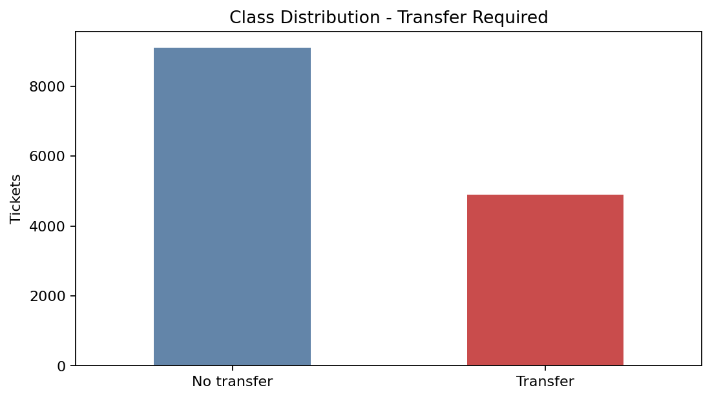

### Exploratory Analysis
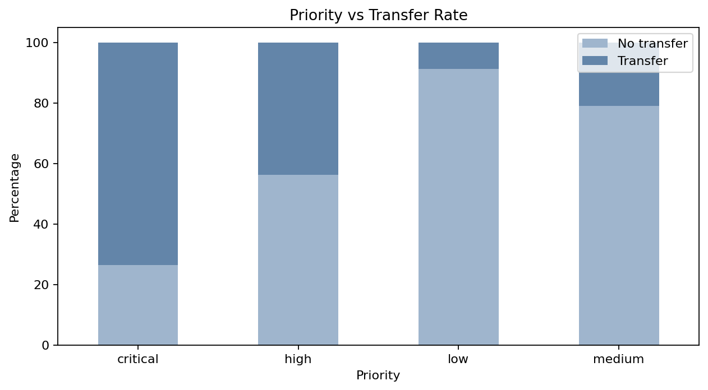

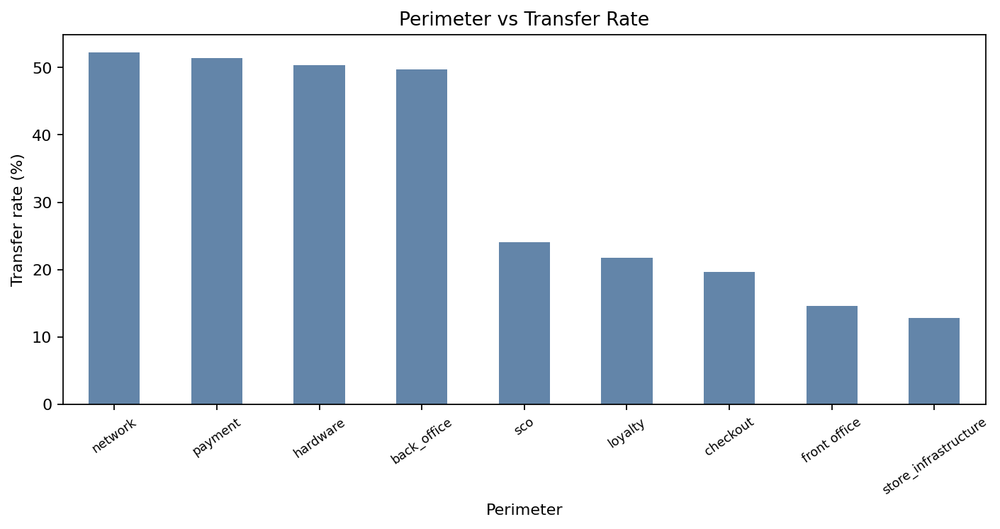

## 4. Preprocessing Pipeline
The preprocessing pipeline applies lowercase normalization, punctuation cleanup, English stopword removal through TF-IDF, categorical one-hot encoding, and median imputation for numeric fields. Missing text is converted to an empty string while numeric missing values are imputed within the pipeline.

## 5. Feature Engineering
The benchmark uses the requested features:
- `title`
- `description`
- `perimeter`
- `priority`
- `sla_breached`
- `resolution_time_minutes`
- `incident_category`

Title and description are concatenated into a text feature and vectorized with TF-IDF using unigrams and bigrams. Categorical fields are one-hot encoded. Numeric features are imputed and scaled.

## 6. Train/Test Split Strategy
A deterministic stratified split is used with `random_state=20260525`:
- Train: 70%
- Validation: 15%
- Test: 15%

The final metrics below are reported on the test split only.

## 7. Models Used
1. **Logistic Regression**: interpretable baseline.
2. **Random Forest**: explainable ensemble model for nonlinear effects.
3. **XGBoost**: main enterprise candidate model.

No SVM, LightGBM, deep learning, BERT, or Transformers were used.

## 8. Evaluation Metrics
Each model is evaluated with Accuracy, Precision, Recall, F1-score, ROC-AUC, training time, and inference time.

### 5-Fold Cross Validation
Cross-validation is computed on the training split using accuracy as the scoring metric. It estimates score stability across different folds without touching the held-out test split.

| Model | Mean Accuracy | Std Deviation |
| --- | --- | --- |
| Logistic Regression | 0.740 | 0.010 |
| Random Forest | 0.808 | 0.006 |
| XGBoost | 0.843 | 0.006 |

## 9. Benchmark Results
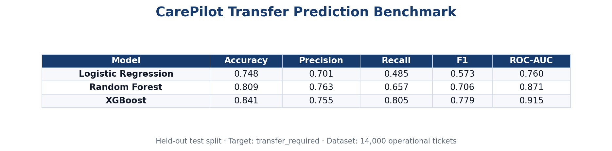

| Model | Accuracy | Precision | Recall | F1 | ROC-AUC |
| --- | --- | --- | --- | --- | --- |
| Logistic Regression | 0.748 | 0.701 | 0.485 | 0.573 | 0.760 |
| Random Forest | 0.809 | 0.763 | 0.657 | 0.706 | 0.871 |
| XGBoost | 0.841 | 0.755 | 0.805 | 0.779 | 0.915 |

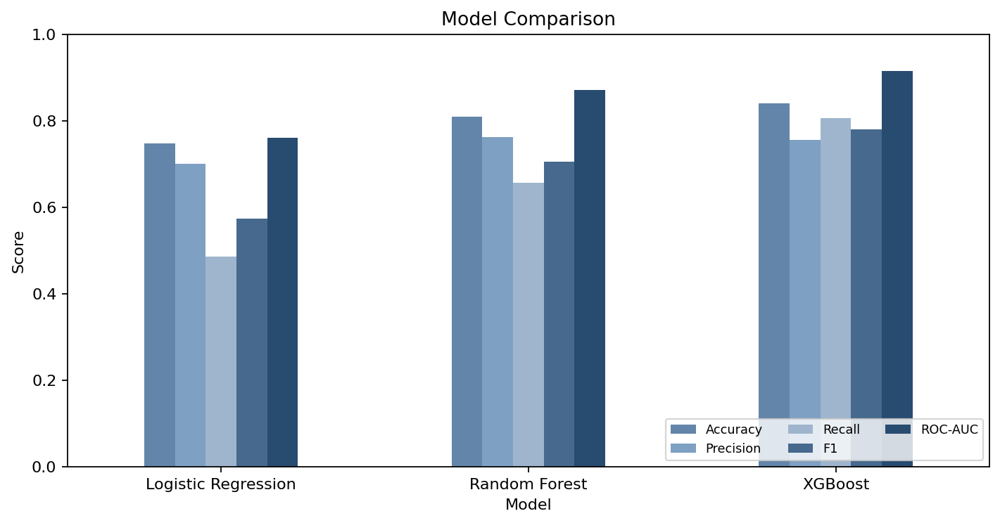

### Runtime Metrics
| Model | Training Time (s) | Inference Time (ms/row) |
| --- | --- | --- |
| Logistic Regression | 0.3529 | 0.0573 |
| Random Forest | 0.6415 | 0.1054 |
| XGBoost | 4.3304 | 0.1050 |

## 10. Confusion Matrix Interpretation
The confusion matrices show how each model trades off false transfer suggestions and missed transfers. For enterprise support, false negatives are operationally important because missed transfers can delay resolution. False positives also matter because unnecessary routing increases handover cost.

Best model by F1-score: **XGBoost**.

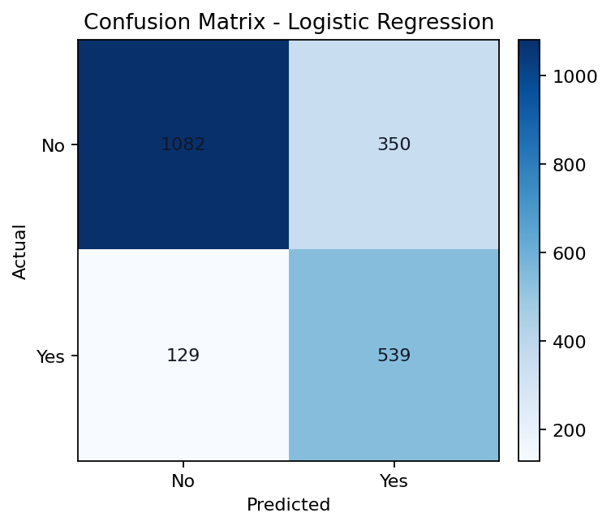

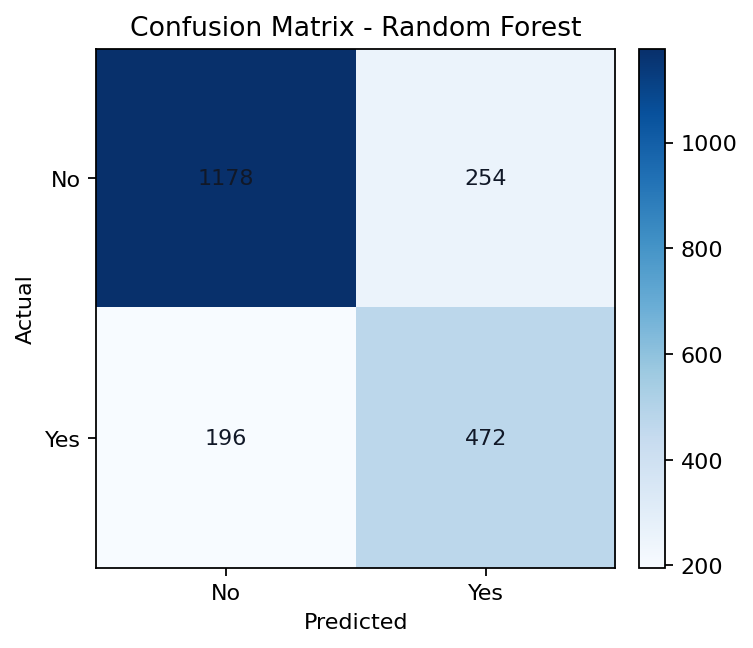

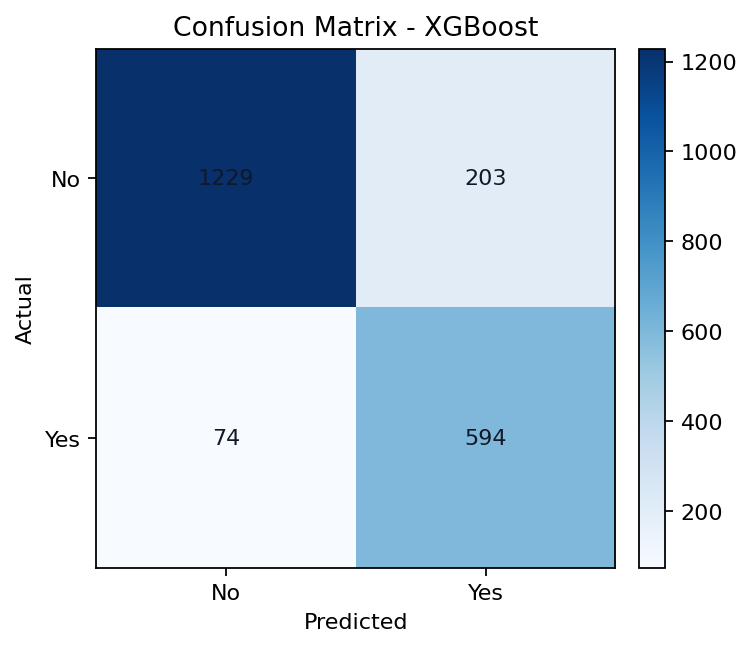

### Normalized Confusion Matrices
The normalized matrices express each actual class as percentages. This is useful for reading recall behavior directly.

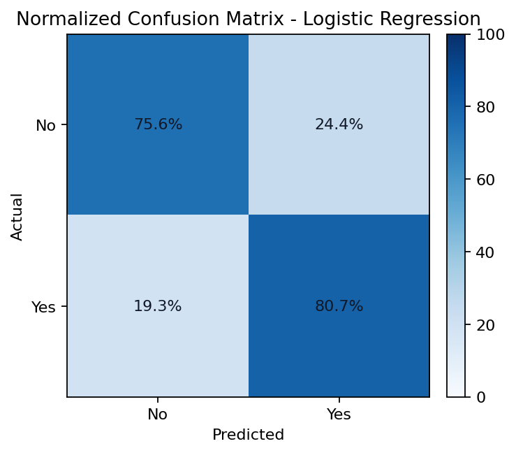

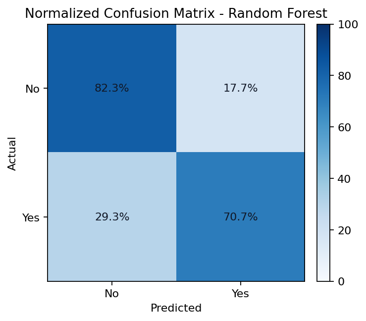

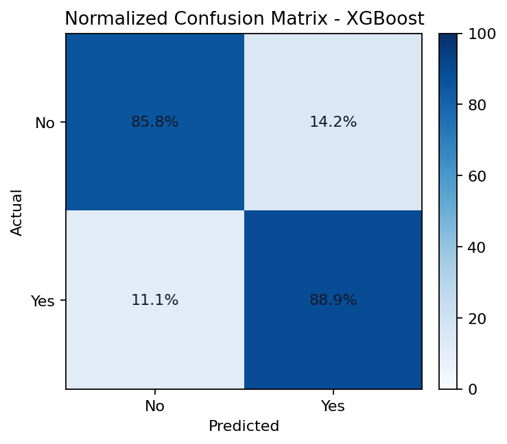

## 11. Classification Report
The per-class classification report shows the precision, recall, and F1-score for both transfer and non-transfer classes.

### Logistic Regression
| Class | Precision | Recall | F1-score | Support |
| --- | --- | --- | --- | --- |
| No transfer | 0.763 | 0.889 | 0.821 | 1366 |
| Transfer | 0.701 | 0.485 | 0.573 | 734 |

### Random Forest
| Class | Precision | Recall | F1-score | Support |
| --- | --- | --- | --- | --- |
| No transfer | 0.828 | 0.890 | 0.858 | 1366 |
| Transfer | 0.763 | 0.657 | 0.706 | 734 |

### XGBoost
| Class | Precision | Recall | F1-score | Support |
| --- | --- | --- | --- | --- |
| No transfer | 0.891 | 0.859 | 0.875 | 1366 |
| Transfer | 0.755 | 0.805 | 0.779 | 734 |

## 12. ROC Curve Interpretation
The ROC curve compares model discrimination across decision thresholds. Higher ROC-AUC indicates better ability to rank tickets by transfer risk, which is useful for supervisor triage.

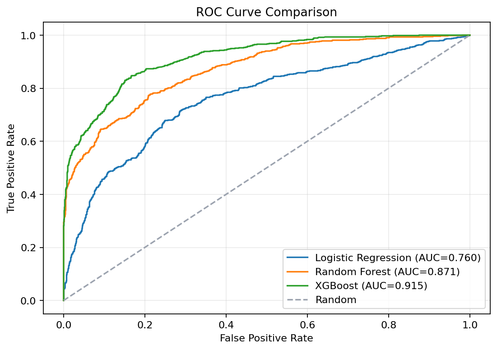

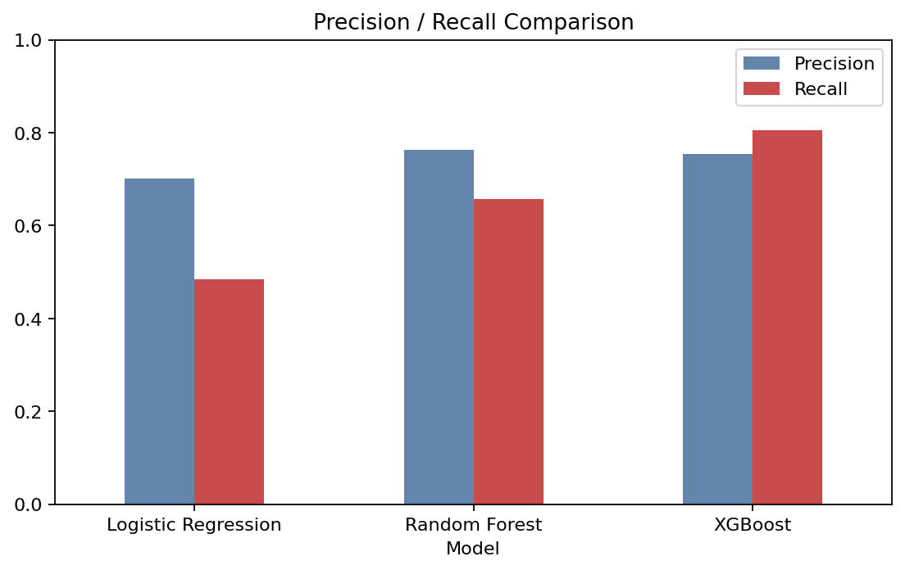

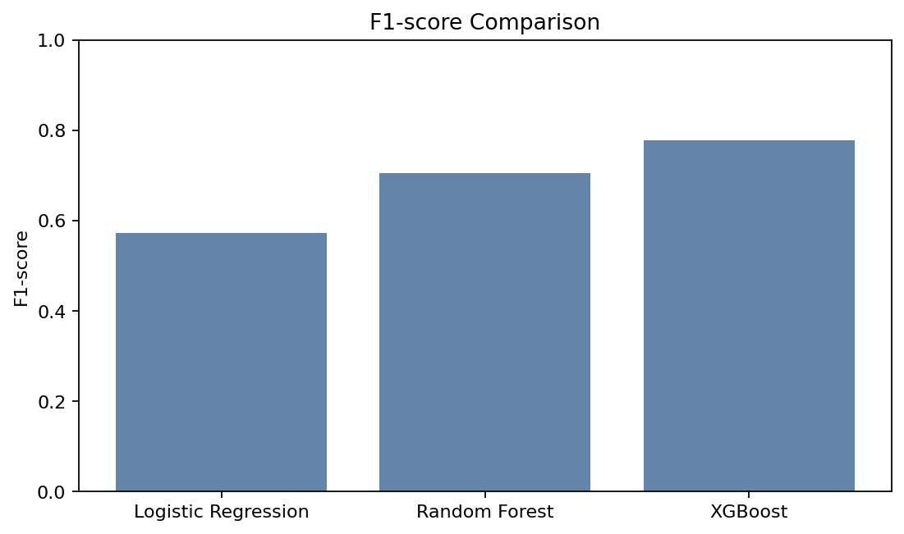

## 13. Feature Importance Analysis
Feature importance is reported for Random Forest and XGBoost. The most useful signals usually include priority, SLA breach, perimeter, incident category, and key text terms from operational descriptions.

### Random Forest
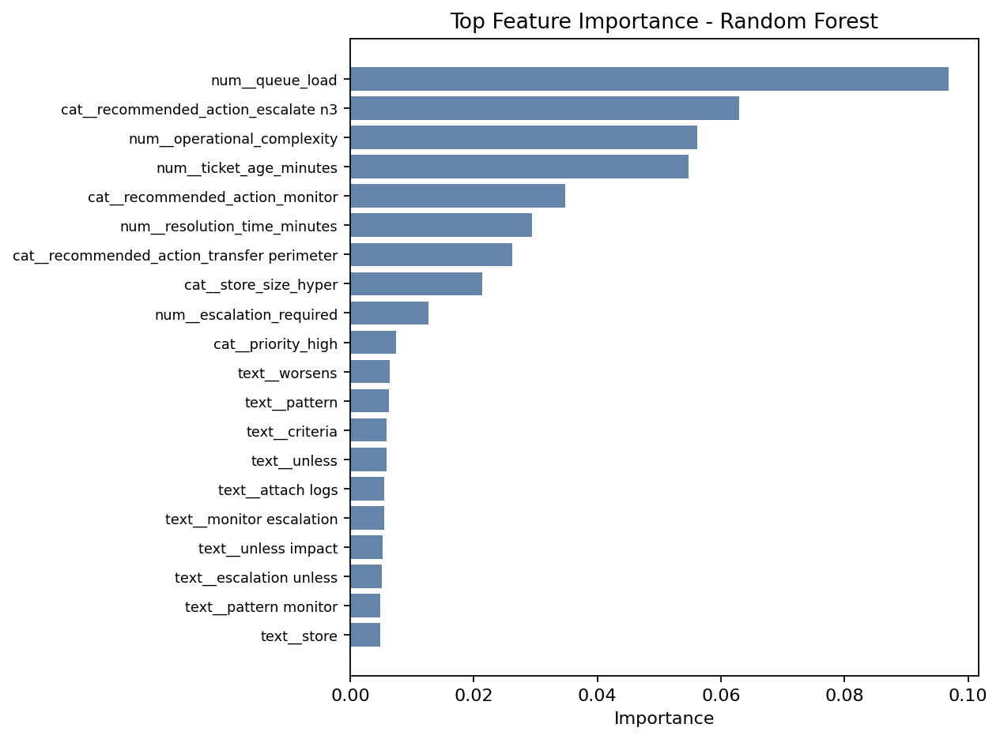

### XGBoost
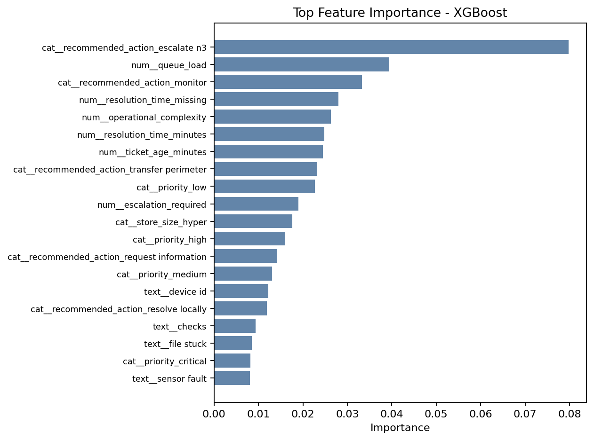

## 14. Executive Interpretation
- Logistic Regression provides strong interpretability but lower transfer recall, making it useful as a transparent baseline rather than the operational candidate.
- Random Forest improves nonlinear pattern handling and provides feature importance, but its recall remains below XGBoost in this benchmark.
- XGBoost achieved the best operational balance between recall, F1-score, ROC-AUC, and inference latency.

## 15. Model Selection Justification
**XGBoost** is selected because it provides the strongest recall, the best F1-score, strong ROC-AUC, and acceptable inference latency for an enterprise triage workflow. This makes it the best candidate for transfer-risk ranking in the current benchmark phase.

## 16. Limitations
- Operational noise may evolve as store processes, systems, and support practices change.
- Additional historical coverage may improve generalization across regions, stores, and incident families.
- Resolution-time features are useful for benchmarking but may be unavailable at ticket creation time in a live real-time model.
- No model predictions are connected to operational dashboards or agent workflows.
- Hyperparameter optimization was not explored in this phase.

## 17. Future Improvements
- Add real CARE historical exports.
- Benchmark preprocessing variants: raw text, cleaned text, TF-IDF, CountVectorizer, and embeddings.
- Add confusion matrices per perimeter and priority.
- Add calibration curves and threshold optimization.
- Add model comparison across multiple seeds.
- Evaluate train-time versus inference-time cost for production readiness.

## Saved Visuals
- Class distribution: `03_transfer_distribution.png`
- Priority vs transfer: `03_priority_vs_transfer.png`
- Perimeter vs transfer: `03_perimeter_vs_transfer.png`
- ROC curves: `03_transfer_roc_curves.png`
- Precision/Recall: `03_transfer_precision_recall.png`
- F1-score: `03_transfer_f1_score.png`
