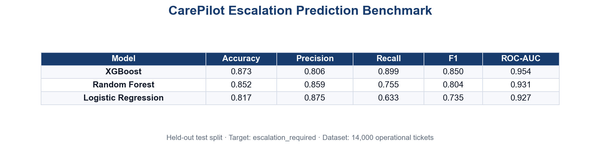

# Escalation Prediction Benchmark Summary

## Objective

Predict whether an operational ITSM ticket requires **escalation to N3** (`escalation_required`). This Task 1 benchmark establishes the CAREPILOT supervised learning methodology: isolated `ml_training` data, three sklearn models, held-out test metrics, and no operational dashboard writes during training.

## Problem Type

- **Binary classification**
- Target: `escalation_required`
- Primary metrics: F1-score, Recall, ROC-AUC

## Dataset Description

- **Source:** `ml_training.historical_tickets`
- **Records:** 14,000 operational tickets
- **Target:** `escalation_required` (~18% positive)
- **Features:** title, description, perimeter, priority, SLA breach, resolution time, incident category
- **Split:** stratified 70% train / 15% validation / 15% test (`random_state=20260525`)

## Preprocessing

- Text normalization on title and description
- TF-IDF vectorization (unigrams + bigrams, English stopwords)
- Categorical one-hot encoding with unknown-category handling
- Numeric median imputation and standard scaling
- Missing-value indicators for sparse fields

## Models Benchmarked

1. **Logistic Regression** — interpretable linear baseline
2. **Random Forest** — nonlinear ensemble with shallow trees
3. **XGBoost** — regularized gradient boosting with class weighting

## Evaluation Metrics

Accuracy · Precision · Recall · F1 · ROC-AUC · 5-fold CV accuracy · Training time · Inference time per row

## Benchmark Results

| Model | Accuracy | Precision | Recall | F1 | ROC-AUC |
| --- | --- | --- | --- | --- | --- |
| XGBoost | 0.873 | 0.806 | 0.899 | 0.850 | 0.954 |
| Random Forest | 0.852 | 0.859 | 0.755 | 0.804 | 0.931 |
| Logistic Regression | 0.817 | 0.875 | 0.633 | 0.735 | 0.927 |

## Interpretation

This benchmark compares three supervised classifiers in order to select the most suitable model for integration into CAREPILOT.

- **Logistic Regression** provides a transparent baseline but under-recalls escalation cases (recall ~63%).
- **Random Forest** improves recall (~76%) with strong precision (~86%).
- **XGBoost** achieves the best F1 (~0.85) and ROC-AUC (~0.95) while maintaining the highest recall (~90%).

**Trade-off:** higher recall reduces missed escalations but increases supervisor review load. XGBoost offers the best operational balance on the held-out test split.

## Selected Model / Method

**XGBoost** selected for production inference based on highest F1 and ROC-AUC.

- Production artifact: `ml/artifacts/models/xgboost.joblib`
- Notebook: `ml/notebooks/escalation/03_escalation_benchmark.ipynb`

## Limitations

- Operational ticket wording is noisy and inconsistent across stores
- Escalation labels reflect historical routing, not always optimal decisions
- Rare escalation sub-scenarios may be underrepresented
- Offline benchmark; production drift requires periodic re-evaluation

## Generated Artifacts

- Models: `ml/artifacts/models/logistic_regression.joblib`, `random_forest.joblib`, `xgboost.joblib`
- Metrics: `ml/artifacts/03_escalation_benchmark_metrics.json`
- PNG table: `ml/plots/03_escalation_benchmark_results_table.png`
- Plots: `03_model_comparison.png`, `03_roc_curves.png`, `03_confusion_matrices.png`
- Report: `ml/reports/03_escalation_benchmark_summary.md`

All results are computed from the held-out test split. No predictions were written to operational dashboards or `cp_agent` tables during benchmarking.
