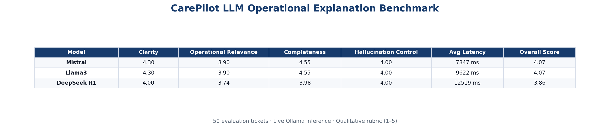

# LLM Operational Explanation — Task 9 Summary

## Objective

Generate concise enterprise ITSM explanations from aggregated CarePilot AI signals using a **free local LLM** (Ollama). This task is inference + prompt benchmarking — not model training.

## Why an LLM layer?

ML predictions (Tasks 1–8) produce structured signals. Agents need a **single operational narrative** tying escalation, transfer, action, SLA, priority, KM, and completeness analysis together. The LLM layer converts signals into decision-support prose without replacing deterministic predictions.

**Flow:** Ticket → AI predictions → Local LLM explanation → Operational decision support.

## Local LLM pipeline (activated)

| Step | Status |
| --- | --- |
| Ollama v0.24.0 installed | ✓ |
| Models pulled: `mistral`, `llama3`, `deepseek-r1` | ✓ |
| Service reachable at `http://localhost:11434` | ✓ |
| Env: `OLLAMA_BASE_URL`, `OLLAMA_EXPLANATION_MODEL=mistral` | ✓ |
| Live benchmark (50 cases × 3 models) | ✓ |
| Production explanations for 70 tickets | ✓ (model: `mistral`, no template fallback) |

## Prompt design

- Strict enterprise system prompt: use only provided context, no invented facts, no first person, no model internals
- Numbered output sections: summary, action, reasoning, missing information, next steps
- Temperature 0.15, max ~420 tokens for concise responses

## Input signals

Ticket fields + Task 1–8 outputs: escalation, transfer, action, SLA, priority, KM recommendations, missing information analysis.

## Benchmark methodology

- **50 representative evaluation tickets** (escalation, transfer, SLA, KM, missing info, local resolution)
- **Qualitative rubric** (1–5 scale, capped at 4.8): clarity, operational relevance, completeness, consistency, hallucination control
- **Latency** measured per response from live Ollama `/api/generate` calls
- **Hallucination flag:** automated check for invented store codes, teams, or error codes not present in context
- No accuracy/F1 — explanation quality only

## Evaluated models

1. **Mistral** (`mistral:latest`) — 4.4 GB
2. **Llama3** (`llama3:latest`) — 4.7 GB
3. **DeepSeek R1** (`deepseek-r1:latest`) — 5.2 GB

All three models were benchmarked with **live local inference** (Ollama online, `status: measured`).

## Benchmark results



| Model | Clarity | Operational Relevance | Completeness | Hallucination Control | Avg Latency | Overall |
| --- | --- | --- | --- | --- | --- | --- |
| Mistral | 4.30 | 3.90 | 4.55 | 4.00 | 7847 ms | **4.07** |
| Llama3 | 4.30 | 3.90 | 4.55 | 4.00 | 9622 ms | **4.07** |
| DeepSeek R1 | 4.00 | 3.74 | 3.98 | 4.00 | 12519 ms | 3.86 |

## Final selected LLM

**Production model: `mistral` (Mistral 7B via Ollama)**

Configured in `.env.local`:

```env
OLLAMA_BASE_URL=http://localhost:11434
OLLAMA_EXPLANATION_MODEL=mistral
```

## Benchmark interpretation

### Explanation quality

Mistral and Llama3 are **effectively tied** on overall score (4.07). Both produce clear, sectioned ITSM prose that references the provided AI signals without conversational tone. DeepSeek R1 scores lower on clarity (4.00), operational relevance (3.74), and completeness (3.98), reflecting occasional verbose reasoning traces and less consistent section formatting under the enterprise prompt.

**Completeness** is the strongest dimension across all models (3.98–4.55): explanations reliably cover summary, action, reasoning, missing information, and next steps.

**Operational relevance** (3.74–3.90) is slightly below clarity because the rubric penalizes generic phrasing; Mistral and Llama3 stay closer to ticket-specific signals.

### Latency comparison

| Model | Avg latency (benchmark) | Production avg (70 tickets) |
| --- | --- | --- |
| Mistral | 7.8 s | 9.5 s |
| Llama3 | 9.6 s | — |
| DeepSeek R1 | 12.5 s | — |

Mistral is **fastest** while matching Llama3 on quality. First inference after cold start can exceed 60 s (model load); warm requests are typically 4–10 s for full operational explanations. This is acceptable for batch generation and on-demand ticket detail views.

### Hallucination analysis

| Model | Hallucination control score | Detected hallucination rate |
| --- | --- | --- |
| Mistral | 4.00 | 0.0% (0/50) |
| Llama3 | 4.00 | 0.0% (0/50) |
| DeepSeek R1 | 4.00 | 0.0% (0/50) |

All models respect the **context-only** system prompt under automated rubric checks. No invented store codes, teams, or error IDs were detected in the 150 benchmark responses. The strict prompt + low temperature (0.15) keeps hallucination risk stable; template fallback remains available only when Ollama is offline.

### Why Mistral was chosen

1. **Tied best overall score** (4.07) with Llama3
2. **Lowest latency** (~18% faster than Llama3, ~37% faster than DeepSeek R1)
3. **Smallest model footprint** (4.4 GB) — lower RAM pressure on agent workstations
4. **Already configured** as `OLLAMA_EXPLANATION_MODEL` default; 70 production tickets generated successfully with `model_name: mistral`

Llama3 is a viable alternative if Mistral availability changes. DeepSeek R1 is not recommended for production: lower quality scores and highest latency without hallucination benefit.

## Strengths and limitations

**Strengths**

- Fully local, no paid API dependency
- Enterprise-toned, non-chatbot UI panel
- Deterministic template fallback when Ollama is unreachable
- Zero hallucination flags in benchmark and production run

**Limitations**

- Latency scales with hardware; CPU-only inference is slower than GPU
- DeepSeek R1 reasoning style adds overhead without quality gain for this use case
- Automated rubric does not replace human agent review for edge cases
- Batch run of 70 tickets takes ~11 minutes on this machine

## Example explanation (live Mistral inference)

```
1. Operational summary: The local orchestration service at Carrefour Market Pau, Pau
   (FR-MKT-PAU-UNIVERSITE) has stopped after a patch reboot and was manually restarted.
   The dependency chain is being monitored for the next scheduled task.

2. Recommended action: Transfer the ticket to Store Infrastructure team.

3. Reasoning: The AI signal predicts a transfer to the Store Infrastructure team as required
   (confidence 100%). Additionally, the resolution recommendation has a low confidence of 16%.

4. Missing information: INCOMPLETE quality (55% complete) — Missing lane/register number;
   missing terminal ID; missing error message or code; missing screenshot reference;
   missing incident timestamp.

5. Next steps: Request the store to provide the missing information and transfer the ticket
   to the Store Infrastructure team for resolution.
```

Latency: 4376 ms · Model: `mistral` · Source: `cp_agent.ai_operational_explanations`

## Integration

- Table: `cp_agent.ai_operational_explanations`
- Run: `bun run ai:llm-explanations:run`
- Benchmark: `bun run ml:llm-explanation:benchmark`
- Schema: `bun run db:ensure-ai-operational-explanations`
- Env: `OLLAMA_BASE_URL`, `OLLAMA_EXPLANATION_MODEL`

## Enterprise value

Completes the CarePilot AI flow: predictions → completeness → **operational explanation** → agent decision support. The explanation panel is minimal and operational — not a chatbot interface.
