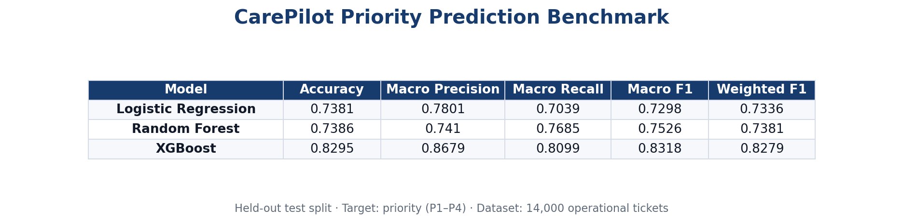

# Priority Prediction Benchmark Summary

## Objective

Predict operational ticket priority (`P1`–`P4`) before manual triage. Task 5 complements escalation, transfer, action recommendation, and SLA prediction to complete the CAREPILOT operational prediction layer.

## Problem Definition

- **Target:** `priority` (multiclass)
- **Classes:** P1, P2, P3, P4
- **Primary metric:** Macro F1

## Dataset Characteristics

Source: `ml_training.historical_tickets` (14000 tickets)

| Priority | Share (%) |
| --- | --- |
| P1 | 15.3 |
| P2 | 26.99 |
| P3 | 41.76 |
| P4 | 15.95 |

- Missing descriptions: 8.01%
- Missing resolution time: 40.89%
- Split: 9800 train / 2100 validation / 2100 test (stratified)

## Preprocessing

Text normalization, TF-IDF, categorical one-hot encoding, numeric imputation/scaling, label encoding for P1–P4. Priority is excluded from features.

## Benchmark Results

| Model               |   Accuracy |   Macro Precision |   Macro Recall |   Macro F1 |   Weighted F1 |   Training Time (s) |   Inference Time (ms/row) |
|:--------------------|-----------:|------------------:|---------------:|-----------:|--------------:|--------------------:|--------------------------:|
| Logistic Regression |     0.7381 |            0.7801 |         0.7039 |     0.7298 |        0.7336 |              0.8576 |                    0.0802 |
| Random Forest       |     0.7386 |            0.741  |         0.7685 |     0.7526 |        0.7381 |              2.1247 |                    0.1856 |
| XGBoost             |     0.8295 |            0.8679 |         0.8099 |     0.8318 |        0.8279 |              8.72   |                    0.1142 |

**Best model:** XGBoost (Macro F1 0.832)

Production artifact: `ml/artifacts/models/xgboost_priority.joblib`

## Operational Implications

- Predicted P1/P2 tickets support proactive queue prioritization and SLA supervision.
- Combined with Tasks 1–4, agents receive a full operational intelligence stack on each ticket.

## Limitations

- Priority labels remain partially correlated with routing outcomes despite controlled ambiguity.
- Live inference uses predicted routing signals from other models when available.
