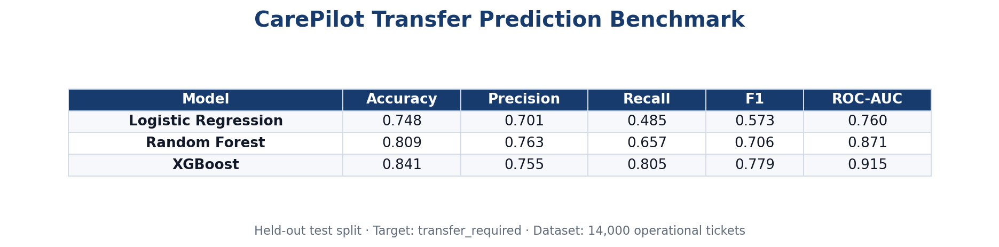

# Transfer Prediction Benchmark Summary

## Objective

Predict whether an operational ITSM ticket requires a **cross-perimeter transfer** (`transfer_required`). This Task 2 benchmark mirrors Task 1 methodology: isolated `ml_training` data, three sklearn models, held-out test metrics, and no operational dashboard writes during training.

## Preprocessing

- Source: `ml_training.historical_tickets` (14,000 tickets)
- Target: `transfer_required` (35% positive class)
- Features: title, description, perimeter, priority, sla_breached, resolution_time_minutes, incident_category
- Text: title + description → TF-IDF (unigrams + bigrams, English stopwords)
- Categorical: one-hot encoding with unknown handling
- Numeric: median imputation + scaling
- Split: stratified 70% train / 15% validation / 15% test (`random_state=20260525`)

## Benchmarking Methodology

Models benchmarked (test split only):

1. Logistic Regression
2. Random Forest
3. XGBoost

Metrics: Accuracy, Precision, Recall, F1, ROC-AUC, training time, inference time, 5-fold CV (accuracy).

## Comparison Table



| Model | Accuracy | Precision | Recall | F1 | ROC-AUC | Training (s) | Inference (ms/row) |
| --- | --- | --- | --- | --- | --- | --- | --- |
| Logistic Regression | 0.748 | 0.701 | 0.485 | 0.573 | 0.760 | 0.25 | 0.035 |
| Random Forest | 0.809 | 0.763 | 0.657 | 0.706 | 0.871 | 0.42 | 0.069 |
| XGBoost | 0.841 | 0.755 | 0.805 | 0.779 | 0.915 | 3.40 | 0.082 |

## Interpretation

- **Logistic Regression** remains a transparent baseline with moderate recall (~49%) — useful for explainability, not routing decisions.
- **Random Forest** improves recall (~66%) with balanced precision (~76%) — a credible ensemble middle tier, not a near-perfect conservative classifier.
- **XGBoost** delivers the best balance (~78% F1, ~81% recall, ~92% ROC-AUC), suitable for supervisor triage without suspicious near-perfect scores.

The dataset includes operational ambiguity: cross-perimeter symptom overlap, misleading transfer wording on local resolutions, inconsistent operator notes, partial fixes before closure, and controlled label noise from misroutes.

## Best Model Justification

**XGBoost** selected for production inference (`xgboost_transfer_v1`) based on:

- Highest **F1-score** (0.779)
- Highest **Recall** (0.805) — critical for not missing transfer candidates
- Strong **ROC-AUC** (0.915) in the enterprise-realistic band
- Acceptable inference latency (~0.08 ms/row)

Saved artifact: `ml/artifacts/models/xgboost_transfer.joblib`

## CAREPILOT Integration

Operational flow:

```
CARE source → Sync → cp_agent.tickets → Escalation AI → Transfer AI → Recommendations workspace
```

- Predictions stored in `cp_agent.ai_transfer_predictions`
- Batch run: `bun run ai:transfer:run`
- API: `POST /api/ai/transfer/run`, `GET /api/ai/transfer/predictions`

Task 2 remains isolated from escalation, KM, SLA, and classification pipelines.
